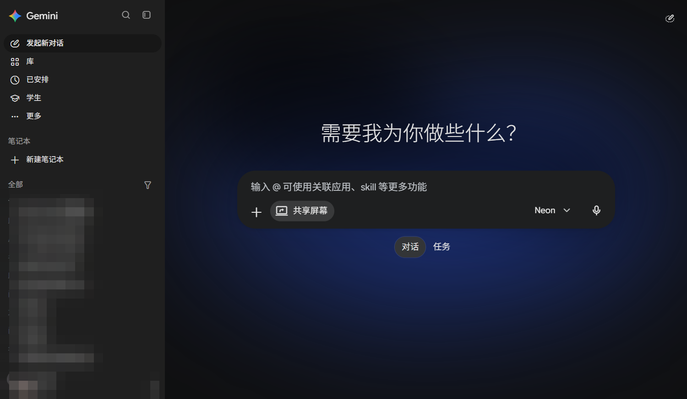

# gemini-zh-cn

把 **Google Gemini Windows 桌面客户端**（Electron 版）的界面汉化为简体中文的一键工具，带完整还原能力。
无第三方依赖，纯 Node 脚本直接改写 `app.asar`；不联网、不上传任何东西。

已在 **Gemini 1.21.1 / Electron 42（Windows 11）** 上实测通过。



> 非官方项目，与 Google 无关联。它只改你本机上已安装的客户端文件，并在首次运行时自动备份原件。

---

## 快速开始

```powershell
git clone https://github.com/d123457/gemini-zh-cn.git
cd gemini-zh-cn
```

然后双击：

| 文件 | 作用 |
|---|---|
| `汉化.cmd` | 打补丁（自动关闭运行中的 Gemini，先备份原件） |
| `状态.cmd` | 查看补丁状态 + 4 项自检 |
| `还原.cmd` | 还原为原版客户端 |

不需要 Node 以外的任何环境；`node` 不在 PATH 时脚本会提示去装。

命令行等价用法：

```powershell
node bin/gemini-zh.js status          # 安装目录 / 版本 / 补丁状态 / 备份 / 是否运行中
node bin/gemini-zh.js apply           # 打补丁（自动生成 app.asar.zhcn-orig 备份）
node bin/gemini-zh.js verify          # 自检：注入点、页面脚本、字典、main.js 可解析
node bin/gemini-zh.js restore         # 回滚到原版
node bin/gemini-zh.js dev --port 9222 # 带调试端口启动（开发用）
node bin/gemini-zh.js harvest         # 汇总运行期收集到的未翻译文案
```

**打一次就长期有效**，之后正常启动客户端（开始菜单 / 快捷方式 / `Alt+G`）都是中文。
只有这三种情况需要再点一次 `汉化.cmd`：客户端升级到新的 `app-x.y.z` 目录、你手动还原过、asar 被覆盖。

---

## 原理

### 1. 英文到底来自哪

客户端自己带的 i18n（`src/_locales/*`，219 条）其实**早就包含 `zh_CN` 且已翻译**，壳层菜单本来就是中文；
满屏英文的是内嵌网页 `https://gemini.google.com/app`——服务端按请求的 `Accept-Language` / `hl` 决定返回哪种语言，
而这个客户端默认按英文协商。

所以本工具的主力不是"翻译壳子"，而是**把语言协商拉到 zh-CN**，再叠一层 DOM 兜底翻译。

### 2. 三层做法

| 层面 | 做法 |
|---|---|
| 语言协商 | 启动加 `--lang=zh-CN` / `--accept-lang`；对 `*://*.google.com/*` 强制注入 `Accept-Language: zh-CN,zh;q=0.9`；主框架导航自动补 `?hl=zh-CN` |
| 页面兜底 | 通过 `WebContents.debugger` 在每个新文档建立时注入 `src/zhcn-page.js`：精确词表 + 正则规则 + `MutationObserver` 增量翻译，并**跳过**输入框、代码块、对话正文、Material 图标 ligature |
| 自愈 | 每 6 秒巡检，页面被整体替换或 debugger 掉线会自动重新注册注入 |

服务端命中 zh-CN 后返回的是完整中文包（日志可见 `BardChatUi.zh_CN`），DOM 层只处理没翻干净或按英文写死的少量文案。

---

## 两个硬坑（工具里已处理，改别人的客户端时值得一看）

### 坑 1：asar 完整性校验把 exe 和 asar 焊在一起

重新打包 asar 后进程直接崩：

```
[FATAL:electron\shell\common\asar\asar_util.cc:357] Integrity check failed for asar archive entry '<header>'
(5931171c...0e00 vs b10e2ec5...d552, 48641 bytes)
```

header JSON 里没有 `integrity` 根键，期望值其实**嵌在 `Gemini.exe` 的 PE 资源**里：

```
INTEGRITY\ELECTRONASAR
[{"file":"resources\\app.asar","alg":"SHA256","value":"<64 hex>"}]
```

同时 fuse wire 打开了 `EnableEmbeddedAsarIntegrityValidation`（版本 1.21.1 里是 fuse #4，位于 exe 偏移 202790504，
`version=1, count=9, states="010011001"`）。

`lib/exe.js` 的处理是确定性的：按上面那段 JSON 锚点定位并改写 64 位哈希，再把 fuse #4 置 `0` 关掉校验；
`restore` 会把原始哈希写回、fuse 复位 `1`。**注意**：靠"搜索旧哈希字符串"来定位是不可靠的——补丁打两次之后
旧值就不存在了，还原时会把 exe 留在中间态导致原版启动即崩。

### 坑 2：`webContents.executeJavaScript` 对这个视图不返回

调用既不 resolve 也不 reject（页面装在 `WebContentsView` 里），所以注入一律走 debugger 通道：

```js
wc.debugger.attach("1.3");
await wc.debugger.sendCommand("Page.enable");
await wc.debugger.sendCommand("Page.addScriptToEvaluateOnNewDocument", { source: pageCode });
// dom-ready / did-finish-load / 定时巡检 时再补一次
await wc.debugger.sendCommand("Runtime.evaluate", { expression: "if (window.__zhcnInstalled !== true) {" + pageCode + "}" });
```

顺带解决了 SPA 导航后注入丢失的问题。

---

## 目录结构

```
gemini-zh-cn/
├─ bin/gemini-zh.js       CLI 主程序（status/apply/verify/restore/dev/harvest）
├─ lib/asar.js            无依赖 asar 读写（含 integrity 重算）
├─ lib/exe.js             Electron fuse / PE 内嵌 header 哈希处理
├─ src/zhcn-bootstrap.js  注入到 src/main.js 顶部的主进程引导层
├─ src/zhcn-page.js       注入到网页主世界的 DOM 汉化层
├─ dict/zh-CN.json        词表（279 条，可自行追加）
├─ dict/rules.json        正则规则（45 条，"3 days ago" / "Show 12 more" 之类动态文案）
├─ tools/check-asar.js    原始/补丁 asar 逐文件对拍
├─ tools/cdp.js           CDP 小工具（开发用）
└─ 汉化.cmd / 还原.cmd / 状态.cmd
```

---

## 扩充词表

1. 正常用一会儿客户端（未翻译文案默认会收集到 `%APPDATA%\gemini\zhcn-missing.ndjson`）；
2. `node bin/gemini-zh.js harvest` 看高频项；
3. 把词条补进 `dict/zh-CN.json`（`"English": "中文"`）或 `dict/rules.json`（`["正则", "替换"]`）；
4. 重新 `apply`。

调试开关（启动前设环境变量）：

| 变量 | 效果 |
|---|---|
| `GEMINI_ZH_DEBUG=1` | 写 `%APPDATA%\gemini\zhcn-debug.log` |
| `GEMINI_ZH_DUMP=1` | 写 `zhcn-dump.txt`（注入状态、词条数、未命中项、可见文本） |
| `GEMINI_ZH_SNAP=1` | 写 `zhcn-shot.png`（截图） |

---

## 常见问题

**Q：升级客户端后失效了？**
新版装进新的 `app-x.y.z` 目录，那里是全新 asar。重新双击 `汉化.cmd`（会自动挑最新版本目录）。

**Q：界面还有零星英文？**
专有名词是故意保留的（模型名如 `Neon`、单词 `skill` 等）。其余按上面"扩充词表"补。

**Q：`还原.cmd` 之后能完全回到原样吗？**
能。`resources\app.asar.zhcn-orig` 是首次运行时自动生成的原始备份，`restore` 会把它复制回去，
并把 exe 的 fuse 与内嵌哈希复位。这条路径有回归验证。

**Q：为什么还在用 exe 里的完整性记录，直接删掉不行吗？**
删不掉——那是 PE 资源，而且校验开关在 fuse 里。改哈希 + 关 fuse 是最小改动方案。

---

## License

[MIT](LICENSE)